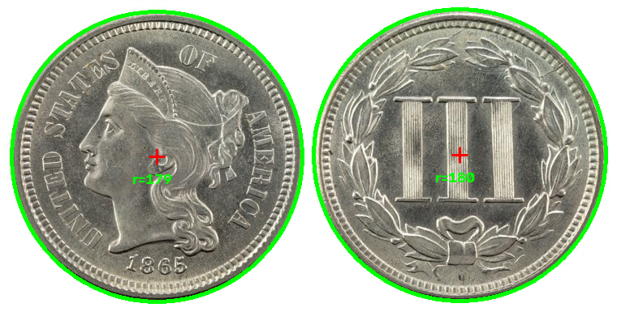
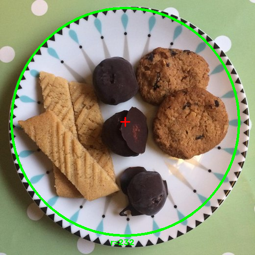

# 霍夫圆检测小工具

基于 OpenCV `HoughCircles` 的桌面小工具：导入图片、拖动滑块调参、实时预览检出的圆，并把标注结果导出成图片。界面用 Python 标准库 `tkinter`，不需要额外 GUI 依赖。



## 功能

- **导入图片**：支持 `jpg / jpeg / png / bmp`，打开后立即用当前参数检测一次。
- **调参**：`dp`、`minDist`、`param1`、`param2`、最小/最大半径六个滑块，拖动后自动重新检测（150 ms 防抖）。
- **预览**：画布按窗口大小等比缩放显示标注结果，状态栏给出检出数量与各圆半径。
- **导出标注图**：把当前参数下的结果另存为 PNG/JPEG。
- **参数预设**：内置两张验收样例图的参数，一键套用。

## 环境要求

- Python 3.10 及以上（开发与验收使用 3.13）
- 依赖：`opencv-python`、`numpy`、`Pillow`；`tkinter` 随官方 Python 一起安装

```bash
python -m pip install -r requirements.txt
# 国内网络可换清华源
python -m pip install -r requirements.txt -i https://pypi.tuna.tsinghua.edu.cn/simple
```

## 启动方式

```bash
python run.py                      # 空白启动，在界面里点「导入图片」
python run.py examples/coins.jpg   # 启动时直接打开指定图片

# 等价写法（源码在 src/ 下，需先让 Python 找到包）
PYTHONPATH=src python -m hough_tool
```

界面右上角两个按钮合成一组常规流程：**导入图片 → 调参/套用预设 → 看预览 → 导出标注图**。

## 参数说明

| 参数 | 含义 | 调大后的效果 |
| --- | --- | --- |
| `dp` | 累加器分辨率相对原图的比例 | 精度提高、速度变慢 |
| `minDist` | 两个圆心之间的最小距离 | 抑制同一个圆被重复检出 |
| `param1` | Canny 边缘检测高阈值 | 只保留更强的边缘，漏检风险上升 |
| `param2` | 圆心累加器阈值 | 更严格，检出的圆更少、更可靠 |
| `minRadius` / `maxRadius` | 半径范围，0 表示不限 | 收窄范围可排除明显不符的圆 |

## 验收参数与结果

两张实拍图都在 `examples/`，按表中参数可复现下面的结果（界面里点同名预设即可）。

| 图片 | dp | minDist | param1 | param2 | minRadius | maxRadius | 检出结果 |
| --- | --- | --- | --- | --- | --- | --- | --- |
| `examples/coins.jpg` | 1.2 | 200 | 120 | 40 | 160 | 200 | 2 个圆：r=179、r=180，分别贴合两枚硬币外缘 |
| `examples/cookie-plate.jpg` | 1.2 | 200 | 120 | 30 | 220 | 270 | 1 个圆：r=243，贴合盘沿 |

### coins.jpg —— 标出两个硬币外缘


### cookie-plate.jpg —— 标出一个盘沿



## 命令行用法

界面之外还有一条无界面的命令行通道，便于批量出图和自动比对：

```bash
# 复现硬币图结果
PYTHONPATH=src python -m hough_tool.cli --image examples/coins.jpg \
    --out out/coins.png --min-dist 200 --param1 120 --param2 40 --min-radius 160 --max-radius 200

# 复现盘子图结果
PYTHONPATH=src python -m hough_tool.cli --image examples/cookie-plate.jpg \
    --out out/plate.png --min-dist 200 --param1 120 --param2 30 --min-radius 220 --max-radius 270

# 只输出 JSON，便于脚本断言
PYTHONPATH=src python -m hough_tool.cli --image examples/coins.jpg --json
```

`--out` 省略时只打印结果；进程退出码在检出到圆时为 0，未检出为 1。

## 测试

```bash
python -m unittest discover -s tests -v
```

9 条用例覆盖两张样例图的检出数量、半径区间、圆心位置，以及纯色图、绘制副作用等边界情况。

## OpenSpec 变更记录

规格确认、实施进度和验收结果都在 `openspec/changes/add-hough-circle-tool/`：

- `proposal.md`：为什么做、改什么、能力边界
- `specs/hough-circle-tool/spec.md`：界面能力与两张样例图的可验收场景
- `design.md`：参数对象、预处理、绘制与界面结构的技术取舍
- `tasks.md`：实施与验收任务清单，已完成项附实测结果

```bash
openspec validate add-hough-circle-tool --strict   # Change 'add-hough-circle-tool' is valid
openspec list                                      # 4/4 任务完成
```

## 交接状态与接手

本分支用于交接当前工作：图片检测功能已完成并按下文参数验收；**「导入视频完成检测」仅作为后续规划，本分支不含任何视频实现**。

- **复现验收**：克隆本分支后执行 `python -m unittest discover -s tests -v`（9 条用例全部通过），再按「验收参数与结果」的命令或界面预设跑两张样例图，检出数量与半径应与表中一致。
- **当前完成状态、未验证事项与后续待办**（含视频需求的接手入口）：见 `openspec/changes/add-hough-circle-tool/tasks.md` 的「交接状态」小节。

## 项目结构

```
hough-circle-tool/
├── run.py                      # 启动入口
├── requirements.txt
├── src/hough_tool/
│   ├── detector.py             # 参数对象与 HoughCircles 封装
│   ├── annotate.py             # 画圆、画圆心、写文件
│   ├── gui.py                  # tkinter 界面
│   └── cli.py                  # 无界面命令行
├── examples/                   # 两张验收实拍图
├── docs/results/               # 两张标注结果图
├── tests/test_detector.py      # 验收与边界测试
└── openspec/                   # OpenSpec 项目与变更记录
```

## 样例获取方式与来源

两张验收样例图已随仓库提交在 `examples/` 目录，克隆仓库后直接可用，无需另行下载或申请。

图片来自练习仓库 `Ecrypted-Data/rt-git-openspec-lab` 的 `examples/hough/`，仅用于本次培训验收。
